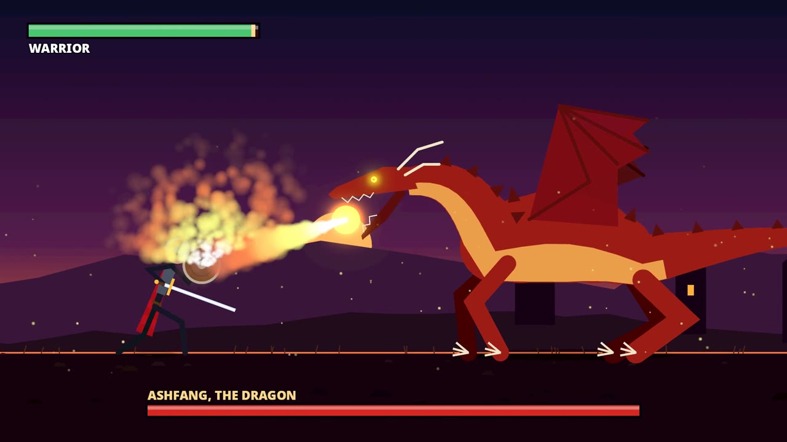
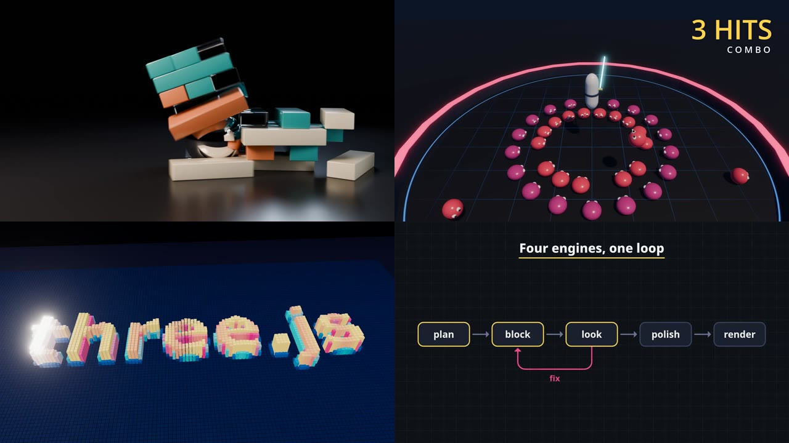

# Agentic Animation Study

Which frameworks let an AI coding agent make animation on its own, and how should that agent work? This repository is the full study: the framework research, the agent skill it produced, the installs and smoke tests, and three rounds of showcase animations, later repeated for a fifth framework, each written, rendered and checked by a coding agent following that skill.

[](media/warrior-dragon-godot.mp4)

*Warrior vs Dragon (20 s, Godot 2D). Click for the video; the [Motion Canvas](media/warrior-dragon-motion-canvas.mp4) and [HyperFrames](media/warrior-dragon-hyperframes.mp4) versions are drawn from the same baked choreography ([all three side by side](media/warrior-dragon-compare.mp4)). Every video of the study, side by side by round: [docs/10](docs/10-compare.md).*

## Findings

- **Five routes cover nearly everything:** Blender for 3D video, Godot for action and game feel, Three.js for 3D on the web, Motion Canvas for programmed 2D video, and HyperFrames, added later, for web-native 2D video (UI, type, captions, footage). Blender's Grease Pencil covers a hand-drawn 2D look as part of the Blender route. [Why these, and why not the others](docs/01-framework-selection.md).
- **What matters is control, not features.** An agent needs plain-text scenes, a headless render, frames that come out the same every time, and single frames it can render and inspect. Tools that only export through a GUI, such as StykAnimate and Stykz, were rejected however good their output.
- **The agent only sees animation through frames it renders and opens.** The skill's core step, *Look*, renders stills and numbered contact sheets for every beat and checks them against a timed beat sheet. In this study that step caught an off-screen ball, fire aimed at the ground, a leap through a dragon's head, wings standing up like sails, a full-screen glow haze and a victory squeezed into the last frames. [The skill](docs/02-animation-skill.md).
- **Bake the choreography once, draw it anywhere.** For the final study, one Python file evaluates poses, IK, cloth simulation, hit-stops and the camera, then writes every frame's shapes to JSON. Godot and Motion Canvas only draw them, so both versions match frame for frame. [How](docs/06-warrior-vs-dragon.md).
- **HyperFrames earned a place by going through every round.** Smoke test, its own showcase, the shared 2D fight, Warrior vs Dragon and a beat-for-beat race against Revideo. It is the only route that lays out real web pages and plays real footage inside the video, and its built-in checks caught bugs before rendering. It costs about 2–2.5 times Revideo per frame on the same scenes, plus 12 s of startup per command, and its frames match to the eye on every run but not always byte for byte. [The test](docs/09-hyperframes.md).
- **Render cost spans more than three orders of magnitude** at 1080p on a GTX 745: Cycles ≈ 40 s per frame, Grease Pencil ≈ 2.3 s, Godot Movie Maker ≈ 0.25–0.33 s, Three.js capture ≈ 0.08 s, Revideo ≈ 0.024–0.04 s, HyperFrames ≈ 0.05–0.12 s (0.19 s with footage).

## The showcases

| Study | Videos | Write-up |
| --- | --- | --- |
| **Route showcase**: one scene per framework, chosen to show what each does best | [Blender: Collapse](media/showcase-blender-collapse.mp4) · [Godot: Arena](media/showcase-godot-arena.mp4) · [Three.js: Field](media/showcase-threejs-field.mp4) · [Motion Canvas: Loop](media/showcase-motion-canvas-loop.mp4) · [HyperFrames: Reel](media/showcase-hyperframes-reel.mp4) | [docs/04](docs/04-four-route-showcase.md) |
| **2D routes**: the same stick-figure fight in four 2D styles | [Grease Pencil](media/2d-fight-grease-pencil.mp4) · [Motion Canvas](media/2d-fight-motion-canvas.mp4) · [Godot 2D](media/2d-fight-godot.mp4) · [HyperFrames](media/2d-fight-hyperframes.mp4) · [all four in a grid](media/2d-fight-compare.mp4) | [docs/05](docs/05-2d-routes.md) |
| **Head-to-head**: the Motion Canvas showcase rebuilt beat for beat in HyperFrames | [HyperFrames: Loop](media/showcase-hyperframes-loop.mp4) · [side by side with Motion Canvas](media/showcase-loop-compare.mp4) | [docs/09](docs/09-hyperframes.md) |
| **Warrior vs Dragon**: a 20-second fight, game look, illustration look and shadow-puppet look | [Godot 2D](media/warrior-dragon-godot.mp4) · [Motion Canvas](media/warrior-dragon-motion-canvas.mp4) · [HyperFrames](media/warrior-dragon-hyperframes.mp4) · [all three side by side](media/warrior-dragon-compare.mp4) | [docs/06](docs/06-warrior-vs-dragon.md) |

[](docs/04-four-route-showcase.md)

## Repository layout

| Path | What it holds |
| --- | --- |
| [`docs/`](docs/) | The write-up, in reading order, plus [accepted decisions](docs/adr/) |
| [`skill/animation/`](skill/animation/) | Snapshot of the `/animation` agent skill: workflow, route guides, methods, extension contract |
| [`projects/`](projects/) | Every project's source and `BRIEF.md`: smoke tests, the route showcase, the 2D study, Warrior vs Dragon, Grease Pencil API probes |
| [`media/`](media/) | Final renders (H.264) |
| [`tools/grid.sh`](tools/grid.sh) | Tiles chosen frames into a labelled contact sheet |

## Documentation

1. [Framework selection](docs/01-framework-selection.md): the candidates, what an agent needs, and the verdict on each.
2. [The `/animation` skill](docs/02-animation-skill.md): the base workflow and how specialised skills extend it.
3. [Toolchain and smoke tests](docs/03-toolchain-and-smoke-tests.md): versions, installs, and what each route's first test changed.
4. [Route showcase](docs/04-four-route-showcase.md): one scene per framework, with measured render costs.
5. [2D routes](docs/05-2d-routes.md): choosing a 2D route, Grease Pencil on Blender 5.x, the shared fight.
6. [Warrior vs Dragon](docs/06-warrior-vs-dragon.md): rigs, baked choreography, the three looks and the fixes.
7. [Gotchas](docs/07-gotchas.md): every trap hit during the study, with the fix.
8. [Reproducing the study](docs/08-reproduce.md): set up the tools and re-render any project.
9. [HyperFrames](docs/09-hyperframes.md): the fifth route, tested through every round, with render cost and determinism measured.
10. [Every video, side by side](docs/10-compare.md): all the study's videos by round and route.

To contribute, see [CONTRIBUTING.md](CONTRIBUTING.md).

## Quick start

Re-render the final study (Python 3, Node 20+, ffmpeg, Godot 4.7; full setup in [docs/08](docs/08-reproduce.md)):

```bash
cd projects/warrior-dragon
python3 choreo.py bake                       # writes bake.json: every frame's shapes
cp bake.json motion-canvas/src/ && cp bake.json godot/
(cd motion-canvas && npm ci && DISABLE_TELEMETRY=true npx tsx src/render.ts --out renders/full.mp4)
(cd godot && godot --path . --write-movie renders/frames/f.png --fixed-fps 60 --quit-after 1200)
```

## Test machine

Debian 13 (Linux 6.12), Intel i7-4790S, 15 GB RAM, NVIDIA GeForce GTX 745 (4 GB, driver 580). Every timing in these docs was measured there, often with other renders running at the same time, so treat them as relative.

## License

[MIT](LICENSE) © Luciano Nery. Built by [Luciano Nery](https://lucianonery.dev).
