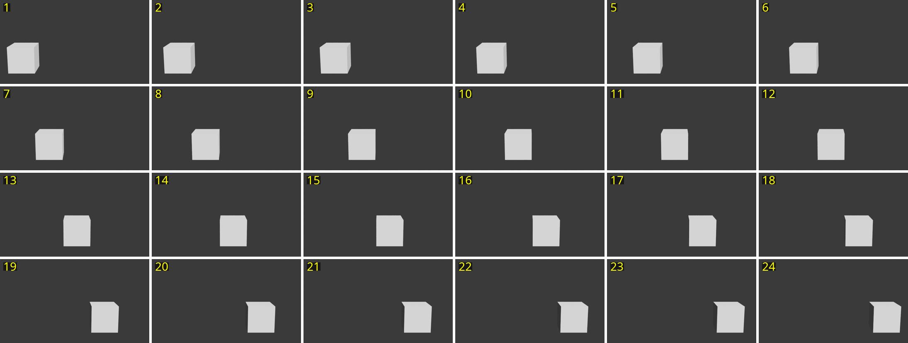
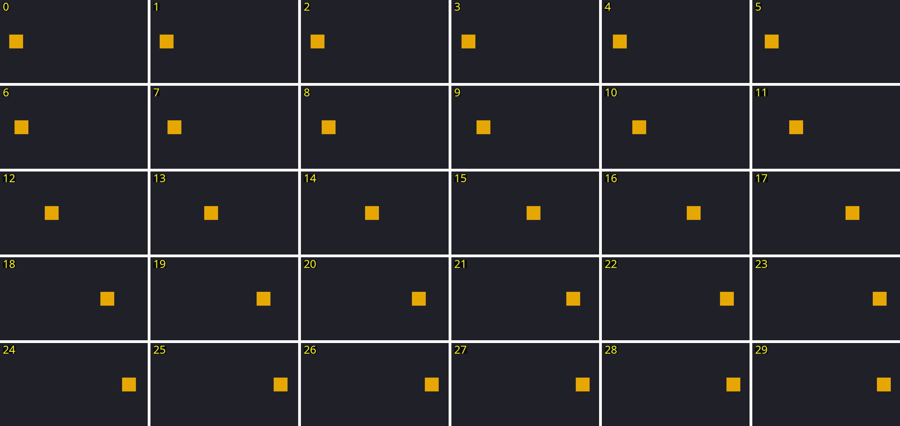
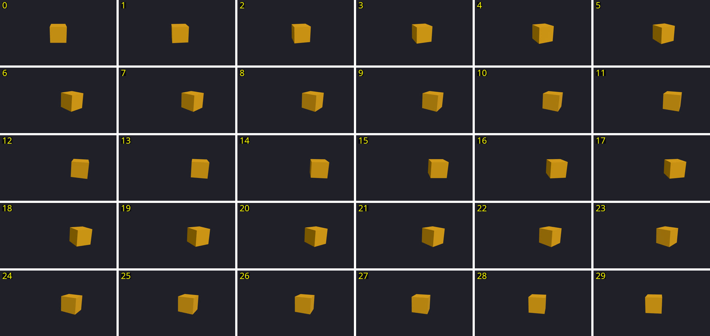
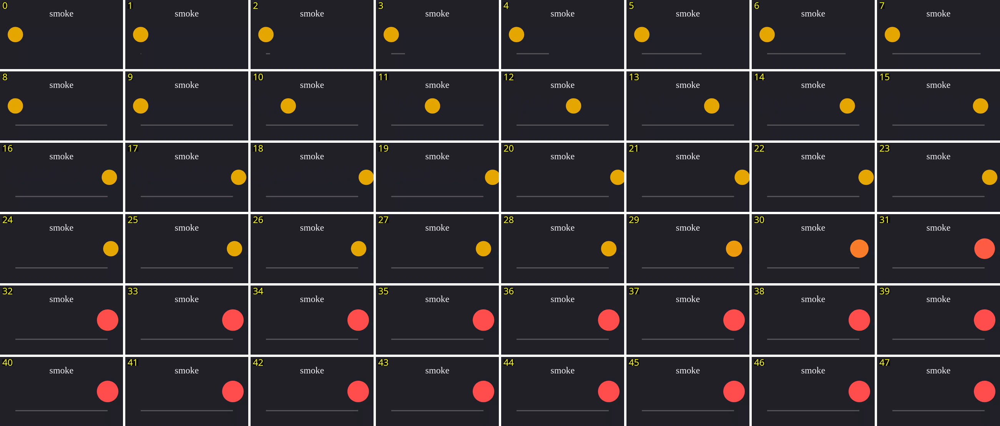
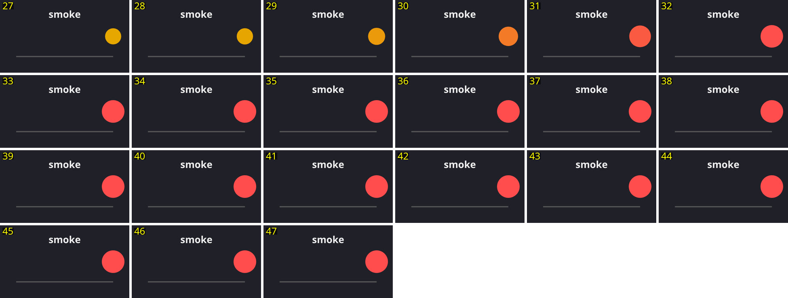

# 3. Toolchain and smoke tests

The route guides were first written from documentation. Then every tool was installed and every route was run exactly as its guide said, so the guides describe what works rather than what the docs claim. The smoke-test projects are in [`projects/smoke/`](../projects/smoke/).

## Versions

| Tool | Version | Install |
| --- | --- | --- |
| Blender | 5.2.2 LTS | Official Linux tarball into user space, SHA-256 verified, linked onto `PATH` |
| Godot | 4.7.2 (standard build) | Official Linux zip, SHA-512 verified, linked onto `PATH` |
| ffmpeg | 7.1.5 | Debian package |
| Node.js / npm | 26.8.1 / 11.19.0 | |
| three | 0.186.1 (r186) | npm, per project |
| Revideo | 0.11.0 | npm, per project (template copied, see below) |
| HyperFrames | 0.9.98 (with GSAP 3.15.0 and its own `chrome-headless-shell` 158) | npm, per project, written by hand rather than `hyperframes init` (see below) |
| Playwright | 1.64.1 | npm, per project, plus `npx playwright install chromium` |
| Python | 3.13 | System (Blender scripts run in Blender's bundled Python) |

## Blender

A script builds a cube, camera and light from an empty scene, keys the cube across 24 frames, saves, and renders. EEVEE, Cycles on CPU and Cycles on the GPU (CUDA) all rendered headless; the contact sheet shows the linear move frame by frame, and the encoded MP4 matched `ffprobe` (24 frames, 24 fps, 1.0 s).

What the test changed in the guide:

- **Engine names.** The guide's tip for listing engines from the RNA enum only returns `BLENDER_EEVEE`; Cycles and Workbench come from add-ons. The 5.x names are `BLENDER_EEVEE`, `CYCLES` and `BLENDER_WORKBENCH` (`BLENDER_EEVEE_NEXT` is gone).
- **Animation API.** `Action.fcurves` no longer exists in 5.x; F-curves live in a channelbag per action slot, reached with `bpy_extras.anim_utils.action_get_channelbag_for_slot(action, slot)`.
- **GPU Cycles** needs a few lines of preferences code passed with `-P` before the render options; the tested snippet is in the guide.
- **Timing.** EEVEE's first render compiles shaders (about 30 s for a trivial scene, 9 s once cached); Cycles on the GTX 745 took about 3 s for that frame.

## Godot

A minimal project tweens a box across the screen and records 30 frames with Movie Maker. It rendered with Vulkan Forward+ on the GPU, even through a virtual X display; the ease-in-out spacing shows clearly on the sheet.

What the test established:

- Movie Maker writes `f00000000.png` (8-digit numbering from 0) plus `f.wav`.
- `--headless` records nothing, because it uses a dummy renderer. On a server, run under `xvfb-run -a` or point `DISPLAY` at a running Xvfb.
- **Starting a preview at a later frame:** pass `-- --from=N`, read it with `OS.get_cmdline_user_args()`, and advance tweens with `custom_step(N / fps)` (or `seek()` an AnimationPlayer). The first recorded frame then matched frame N of a full recording pixel for pixel.

## Three.js

A cube driven by a **frame clock** (every motion a function of `t = frame / fps`, no `requestAnimationFrame`) was captured through Playwright. A separately captured frame 15 was byte-identical to frame 15 of the full run.

What the test changed in the guide:

- Each Playwright version needs its own browser build: `npx playwright install chromium`.
- Headless Chromium defaults to software WebGL (SwiftShader), which is exact but slow. `--use-angle=vulkan --enable-gpu` puts it on the GPU and stays headless; log `UNMASKED_RENDERER_WEBGL` to confirm which one ran.
- The Vite template needs `--no-interactive` to scaffold without prompts.

## Motion Canvas (Revideo)

A ball, a line and a title, rendered headless with Revideo's `renderVideo()`: 48 frames over 1.6 s, exactly the sum of the scene's tweens. A 0.9–1.6 s range render produced 21 frames at 30 fps.

What the test changed in the guide (the most of any route):

- `npm init @revideo@latest` only works interactively and sends a telemetry event; the route copies the `default` template out of the `@revideo/create` package instead.
- npm 11 holds back install scripts until approved. Revideo needs four of them (ffmpeg, ffprobe, esbuild, puppeteer); its telemetry script stays denied. Then `npm rebuild`.
- The template compiles to CommonJS, so the render script wraps `await` in a function.
- Coordinates are pixels with the origin at the canvas centre. The first test placed a ball at ±400 on a 640-wide canvas; the Look step showed it off-screen.
- Set `DISABLE_TELEMETRY=true` for every render.

The final step of the smoke test was to run the setup again, word for word from the guide, in an empty folder. It rendered the same.

## HyperFrames

Added with the fifth route ([ADR 0005](adr/0005-hyperframes-fifth-route.md)). The same scene as the Motion Canvas smoke test, a ball, a line and a title, written as HTML and SVG with a GSAP timeline: 48 frames over 1.6 s at 30 fps, and a 0.9–1.6 s range of 21 frames, the same counts as Revideo. The sheet above is that range as a PNG sequence, frames 27–47. A full render took 15 s, almost all of it startup.

What the test changed in the guide:

- **`hyperframes init` is not the setup.** It prompts, offers to install HeyGen's agent skills, writes `AGENTS.md` and `CLAUDE.md` into the project, loads GSAP from a CDN and pins `npx --yes` in its scripts. The route writes `package.json`, `hyperframes.json` and `meta.json` by hand, with `hyperframes` and `gsap` pinned as local dev dependencies.
- **Telemetry is on by default.** Every command runs with `HYPERFRAMES_NO_TELEMETRY=1`.
- **`check` caught the guide's own bug.** The first example scaled the ball after moving it by its `cx` attribute. GSAP had fixed the transform origin at the old position, so the ball grew 168 px off the right edge; `check` reported the overflow before anything rendered. The example now grows the radius.
- **PNG sequences drop the page background.** They are RGBA and leave out the `body` background that the MP4 keeps, so the first contact sheet came out on white. The background now goes on the composition root.
- **PNG files are numbered from 1**, whatever `--start` is; the tile command reads them with `-start_number 1` and labels them with the range's real frame numbers.

The final step was again to run the setup from the guide, word for word, in an empty folder. Its MP4 decoded to the same frames, byte for byte, as the smoke project's.
