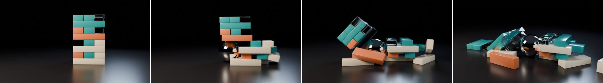
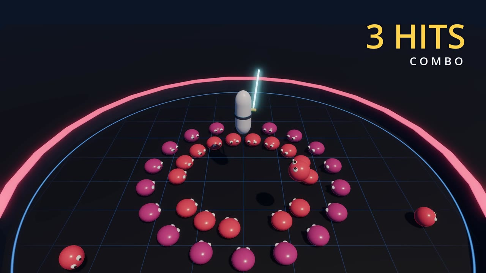
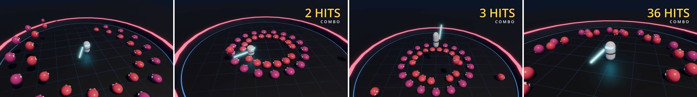
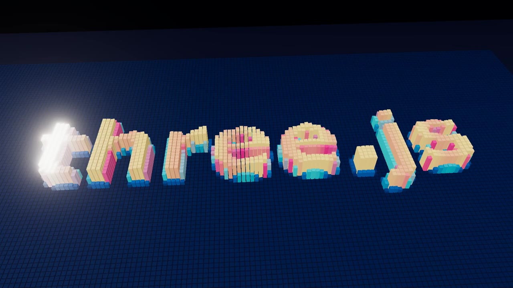
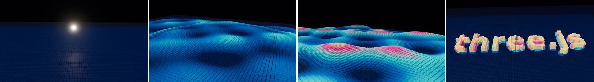
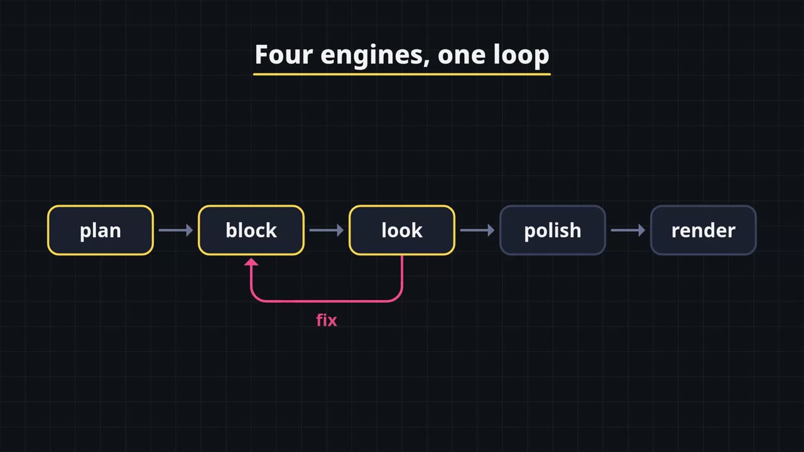
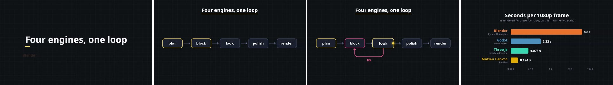

# 4. Four-route showcase

One short scene per framework, each designed around what that framework does best rather than a shared subject. Every project has a `BRIEF.md` with its beat sheet, methods and render commands in [`projects/showcase/`](../projects/showcase/).

## Blender: "Collapse"

*6.0 s, 24 fps, 144 frames. [Video](../media/showcase-blender-collapse.mp4).*

A chrome ball rolls into a tower of glazed ceramic and glass blocks, and the tower collapses.

- **Shows:** image quality. Cycles path tracing with depth of field and motion blur, glass and chrome, a real rigid-body simulation, and a slow orbiting camera that follows the debris.
- **Methods:** the ball's run-up is keyframed as an animated rigid body, then released into the simulation two frames before impact so it keeps its speed. The 24 blocks are Bullet rigid bodies at 10 substeps per frame, baked before rendering so every render matches.
- **Fixed after looking:** the camera cropped the debris; a rim light threw a distracting floor sheen; the first full-quality frame took about 70 s, so samples dropped to 40 with OIDN denoising.
- **Cost:** about 40 s per 1080p frame on the GTX 745. Adding the CPU as a second Cycles device did not help (38 s against 36 s).

## Godot: "Arena"

*7.15 s, 60 fps, 429 frames. [Video](../media/showcase-godot-arena.mp4).*

A hero in a ring of 36 slimes makes three dash strikes, then leaps and slams the ground, blasting every slime into the walls.

- **Shows:** game feel. Each hit freezes the action (hit-stop through `Engine.time_scale`), with screen shake, slash streaks, sparks, a white flash and a shockwave; the slimes are physics bodies knocked into each other and the walls; a combo counter climbs to "36 HITS".
- **Methods:** the beat sheet as frame-exact events in `main.gd`; RigidBody3D slimes frozen until hit, at 120 physics ticks per second; fixed-seed GPU particles.
- **Determinism:** two separate recordings came out byte-identical, physics included.
- **Fixed after looking:** slimes flew over the walls; the camera sat too far back; the hero left the frame at the top of the leap; the slime flash lasted 9 frames instead of 5; the label read "1 HITS".

## Three.js: "Field"

*7.0 s, 60 fps, 420 frames. [Video](../media/showcase-threejs-field.mp4).*

A glowing orb drops onto 14,400 cubes. A ripple spreads, waves build, then the cubes spring up into the word "three.js" and a light sweep crosses it.

- **Shows:** procedural 3D generated in the browser. All cubes are one `InstancedMesh`; the word is drawn on a canvas and sampled onto the grid; bloom comes from `EffectComposer`.
- **Live version:** the same page runs interactively (`npx vite`, open `/?live`, add `&orbit` to steer the camera).
- **Methods:** every cube's height and colour is a function of `t`; the camera follows a Catmull-Rom path through six keys.
- **Fixed after looking:** bloom washed out the word; specular streaks from the splash light on foreground cubes; the final shot framed too high.
- **Cost:** 420 frames captured on the GPU in 33 s.

## Motion Canvas: "Four engines, one loop"

*10.7 s, 60 fps, 643 frames. [Video](../media/showcase-motion-canvas-loop.mp4).*

A typed title names the four routes; the skill's plan → block → look → polish → render loop draws itself and a token runs through it, looping back once through "fix"; a log-scale bar chart then shows what each showcase cost to render per frame.

- **Shows:** programmed 2D motion graphics: typography, an animated diagram and a data chart, with exact timing in TypeScript.
- **Data:** the chart values are real measurements from the four renders: Blender 40 s, Godot 0.33 s, Three.js 0.078 s, Motion Canvas 0.024 s per frame (wall clock, renders overlapping on one machine). Blender's value was read from its render log by [`finish.sh`](../projects/showcase/finish.sh) after its frames finished.
- **Fixed after looking:** reactive `Txt` labels errored during rendering ([gotcha](07-gotchas.md#motion-canvas-revideo)); the diagram and chart crossfaded on top of each other; the chart sat 40 px too high; an `awk` field-split bug wrote 0.0 for Blender.

## Render cost

| Route | Seconds per 1080p frame | Notes |
| --- | --- | --- |
| Blender (Cycles, 40 samples + OIDN + motion blur) | ≈ 40 | 144 frames took about 1.6 hours with other renders sharing the GPU |
| Godot (Movie Maker) | ≈ 0.33 | Mostly PNG writing |
| Three.js (Playwright capture) | ≈ 0.08 | GPU WebGL |
| Revideo | ≈ 0.024 | After about 4 s of startup |

Long Cycles renders belong in the background while other work continues; that is how this showcase was produced.
