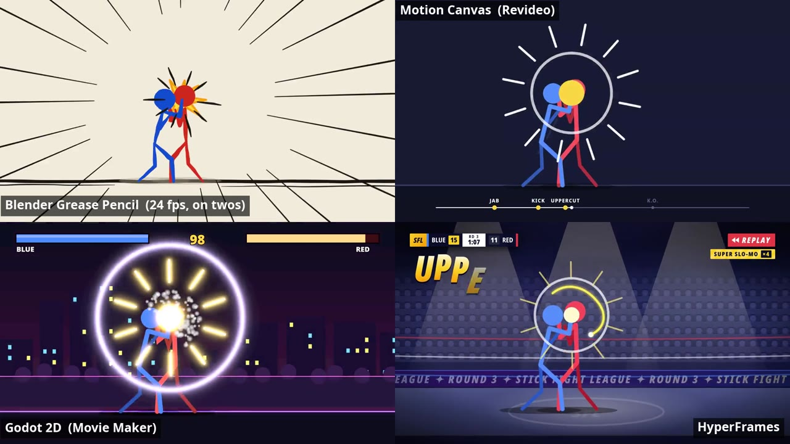
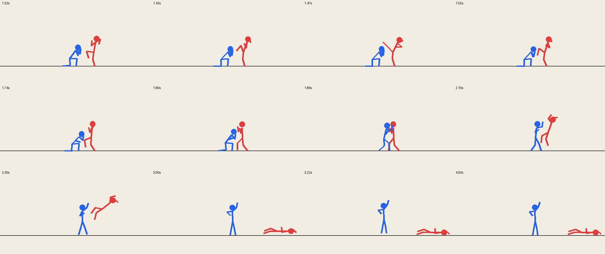
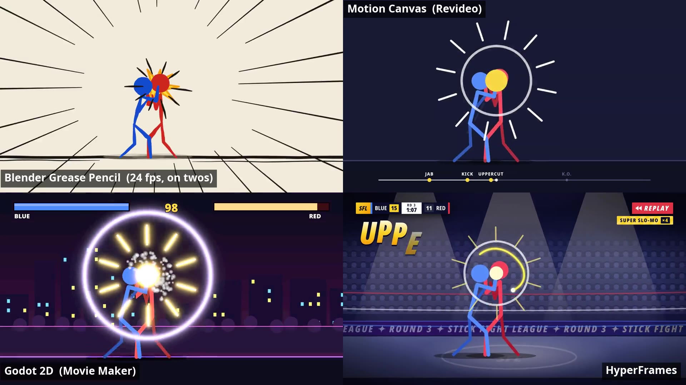

# 5. 2D routes

After the four-route showcase, the open question was 2D: does a code-driven 2D pipeline need its own framework? It doesn't. Two of the four routes already cover most 2D, and the one real gap, a hand-drawn look, is covered by Blender's Grease Pencil ([ADR 0003](adr/0003-2d-without-a-new-framework.md)). HyperFrames joined later for web-native 2D, and the same fight was made with it too ([ADR 0005](adr/0005-hyperframes-fifth-route.md)).

| Kind of 2D | Route | Why |
| --- | --- | --- |
| Explainers, typography, diagrams, UI motion, flat vector characters, stick figures | **Motion Canvas** | Clean vector output, exact timing in code, the fastest renders of the study |
| Combat, platformers, physics, crowds, game feel | **Godot 2D** | The same Movie Maker recording as the 3D arena; hit-stop, physics, particles and glow come with the engine |
| Hand-drawn look: ink lines, line boil, frame-by-frame drawing, 2D in a 3D space | **Blender Grease Pencil** | Another mode of the Blender route, not a new install |
| UI, typography, captions, overlays, real footage | **HyperFrames** | HTML and CSS do the layout and type; footage plays inside the composition |

## One fight, four routes

*Side by side: [video](../media/2d-fight-compare.mp4). Individual clips: [Grease Pencil](../media/2d-fight-grease-pencil.mp4) · [Motion Canvas](../media/2d-fight-motion-canvas.mp4) · [Godot 2D](../media/2d-fight-godot.mp4) · [HyperFrames](../media/2d-fight-hyperframes.mp4).*

A 4.5-second stick-figure fight: Blue's jab lands on Red's block, Red's kick whiffs over Blue's duck, Blue's uppercut launches Red, who lands, bounces and slides. K.O.

### Shared choreography

[`fight.py`](../projects/showcase-2d/fight.py) is the single source of the motion:

- bone lengths and named poses (hip height, torso lean, hand and foot targets);
- timed keys per fighter, each with the easing of the segment that ends at it; hit-stops are `hold` keys;
- Red's flight, sampled from a ballistic arc into linear keys;
- effect events (`trail`, `hit`, `dust`, `ko`) and a shared eased camera pan;
- a reference sampler with two-bone IK for arms and legs.

`python3 fight.py json` writes `fight.json`; each route ports the sampler (Python in Blender, TypeScript, GDScript, JavaScript), so all four hit the same pose on the same frame. For HyperFrames this was checked numerically: `verify-sampler.cjs` runs the page's sampler against `fight.py` on all 270 frames, every joint of both fighters and the camera, and the largest difference is 1e-15. `python3 fight.py preview 0.84 1.86 ...` draws a PIL sheet for tuning poses before any engine runs:

### The four looks

| Route | Look | Cost |
| --- | --- | --- |
| Grease Pencil | Ink on paper, drawn on twos (24 fps), wobbling "boiling" lines, tapered strokes, speed lines, a starburst with manga focus lines on the uppercut, dust curls, hand-lettered "K.O.!" | 253 s for 108 frames (EEVEE, ≈ 2.3 s each) |
| Motion Canvas | Flat vector at 60 fps: trails, impact rings and bursts, a camera punch-in on the uppercut, "FIGHT!" and "K.O." titles, a beat timeline along the bottom | 8 s for 270 frames |
| Godot 2D | Fighting-game layer at 60 fps: health bars with a lagging damage chip, round timer, neon parallax city, HDR glow, spark and dust particles, hit-flash, shake and zoom punch | 58 s for 270 frames; two recordings byte-identical |
| HyperFrames | A TV sports replay at 60 fps: "REPLAY" stinger, scoreboard bug with a running clock, name straps, letter-by-letter calls ("JAB — BLOCKED", "UPPERCUT!"), a "SUPER SLO-MO" tag on the hit-stops, a telestrator that circles the uppercut and draws Red's flight to an X, CSS-lit arena | 33 s for 270 frames (Motion Canvas took 13 s in the same quiet run) |

### Fixed after looking

- With a fixed camera fitting the whole fight, both fighters sat in the left half at the start. Replaced with a shared eased pan, checked numerically: about 390 px of margin on each side at the end.
- Grease Pencil: filled heads and shadows rendered as outlines only. Probing Blender's own Monkey preset showed that fills are switched by the stroke's `fill_id`, not the material ([below](#grease-pencil-on-blender-5x)).
- Motion Canvas: the impact core covered both heads; the flash washed out the frame; Revideo rendered two frames past the scene's end.
- HyperFrames: "UPPERCUT!" rendered as a dark smudge, because the gradient text fill did not reach letters with their own transforms (moved onto each letter); later letters of a call showed for a frame before dropping in (they now start hidden); the kick call was still leaving when the uppercut call began; the telestrator arrow ended 0.95 units above Red's landing; the uppercut flash washed out the centre. `check` also failed straps that would have shown early in a render started mid-clip.
- Godot: the uppercut flash and glow left a grey haze across the screen for six frames. Measuring a corner of the frame (brightness 6 → 144 → 6) traced it to linear-light blending under `hdr_2d` plus the widest glow levels.

## Grease Pencil on Blender 5.x

The Grease Pencil Python API was rewritten in 4.3; code written for the old API, which is also what models tend to produce, fails on 5.x. The probes that established the working calls are in [`projects/grease-pencil-probes/`](../projects/grease-pencil-probes/), and the verified snippet is in the [Blender route guide](../skill/animation/routes/blender.md#grease-pencil-2d). The essentials:

- Data: `bpy.data.grease_pencils.new()`, layers with `gpd.layers.new()` (later layers draw on top), drawings with `layer.frames.new(frame).drawing`, strokes with `drawing.add_strokes([point counts])`.
- Points: set `position` (draw in the XZ plane), `radius` and `opacity`; call `drawing.tag_positions_changed()` afterwards.
- **Fills:** a stroke is filled when its `fill_id` is non-zero; `hide_stroke` hides its outline. The material's `show_fill` and `show_stroke` no longer switch this.
- A drawing holds until the layer's next keyed frame; an empty drawing clears the layer.
- For a hand-drawn look, draw on twos and give each drawing its own small random wobble per point and per stroke.
