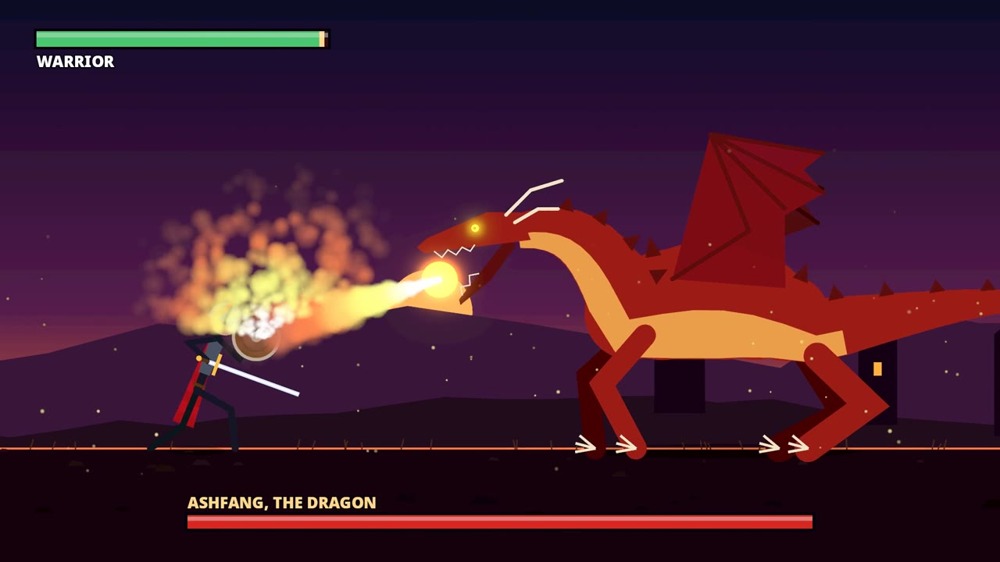
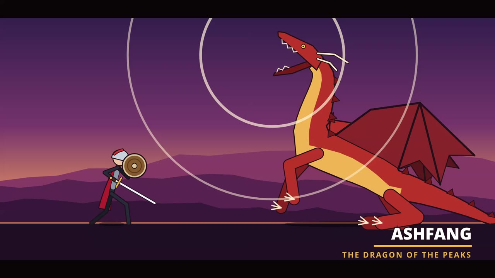
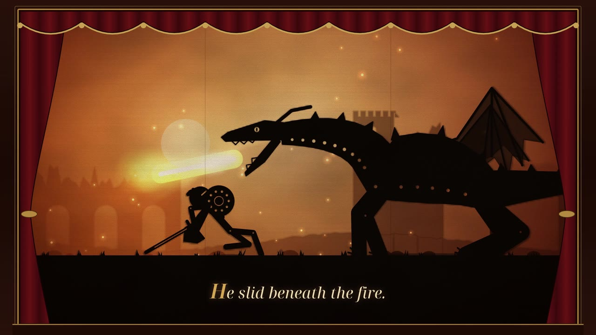
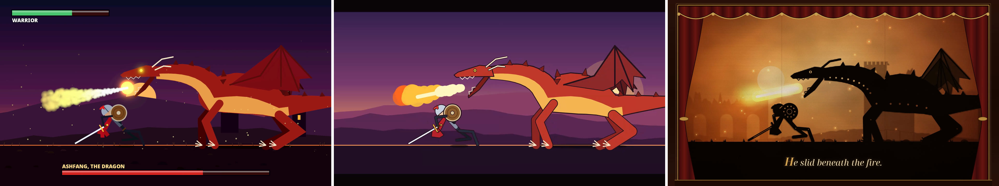
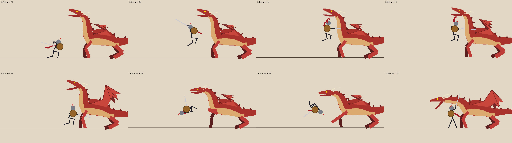
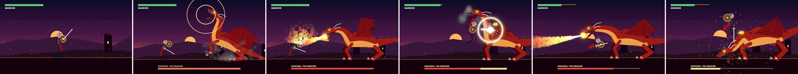
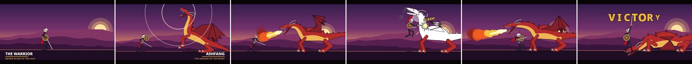
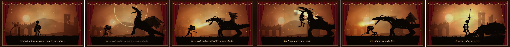

# 6. Warrior vs Dragon

The final study: a 20-second fight between a stick-figure warrior (helmet with plume, cape, sword, round shield) and a dragon, made three times from one baked choreography: a Godot 2D game scene, a Motion Canvas illustration and, added later, a HyperFrames shadow-puppet storybook. Source in [`projects/warrior-dragon/`](../projects/warrior-dragon/); brief and beat sheet in its [`BRIEF.md`](../projects/warrior-dragon/BRIEF.md).

| Godot 2D | Motion Canvas | HyperFrames |
| --- | --- | --- |
|  |  |  |
| [Video](../media/warrior-dragon-godot.mp4): 1200 frames, 60 fps, ≈ 5 min to record | [Video](../media/warrior-dragon-motion-canvas.mp4): 1200 frames, 60 fps, ≈ 50 s to render | [Video](../media/warrior-dragon-hyperframes.mp4): 1200 frames, 60 fps, ≈ 110 s to render |

All three in one frame: [side-by-side video](../media/warrior-dragon-compare.mp4).

## The fight

1. Dusk. The warrior walks in; a shadow sweeps the ground; the dragon drops from the sky, lands hard and roars.
2. It breathes fire into his shield and pushes him back.
3. It rears its head to strike; he charges, leaps under it and slashes the exposed neck.
4. He backflips over a claw swipe; a bite into his shield knocks him into a backward roll.
5. The dragon blasts fire; he sprints and knee-slides under the stream, pops up and cuts its chest.
6. The dragon staggers with its head low; he leaps, flips and plunges his sword into its head.
7. The dragon collapses. He raises his sword: "VICTORY".

## Bake once, draw anywhere

The 2D study kept the choreography as data and ported a sampler to each engine. That worked, but it meant writing the same pose maths three times, and GDScript sampling became the slowest part of the Godot recording. This study went one step further ([ADR 0004](adr/0004-bake-shared-choreography.md)):

[`choreo.py`](../projects/warrior-dragon/choreo.py) evaluates everything in Python and writes **every frame's shapes** to `bake.json` (1200 frames, about 5 MB):

- the camera (centre and zoom, with seeded shake and the zoom punch already applied);
- the warrior's joints, sword (pommel, guard, tip), the simulated cape and plume chains, and the helmet direction;
- the dragon's body outline, belly band, spikes, skull and jaw polygons, teeth, horns, eye, both wings (bones and membrane), four legs with claws, mouth position, fire direction and intensity, and shadow;
- health values and events (hits with position and power, dust, roar, victory).

The Godot, Motion Canvas and HyperFrames versions contain no animation logic. They only draw those shapes in their own style, so the videos match pose for pose; the only thing that differs is the look. The HyperFrames version loads the bake as a script (`bake.js`, a global) and draws frame `round(t × 60)` on every seek.

### What `choreo.py` contains

- **Keyframe tracks.** Named poses plus timed keys with an easing per segment; missing fields carry forward from the previous key.
- **Action time and hit-stops.** Keys are written in action time. Four hit-stops (0.12, 0.10, 0.10 and 0.22 s) freeze action time while real time runs on, so both characters, the fire and the cloth freeze together.
- **The warrior rig.** The stick skeleton from the 2D study (two-bone IK for arms and legs), plus a sword angle in the body frame and a whole-body rotation for flips and rolls.
- **The dragon rig, all procedural:**
  - a body spine with a hump, a tail of 12 segments that curls and sways (and rests on the ground), and a neck drawn as a cubic Bézier to a posed head;
  - a radius profile turned into an outline, a belly band and back spikes;
  - a head built in its own frame, with a jaw rotating about a hinge;
  - wings computed from just two values, *spread* and *flap*: arm, forearm and three fingers fanning a scalloped membrane;
  - legs as two-bone IK to foot targets, either planted on the ground or hanging when flying.
- **Secondary motion.** The cape (9 points) and plume (4 points) are Verlet chains, simulated at 120 Hz with gravity, wind keyed per beat (the roar and the fire blow the cape back) and a flutter term; they freeze during hit-stops.
- **A PIL preview.** `python3 choreo.py preview 6.5 9.2 ...` draws any moments as a sheet in about a second, so the choreography was blocked and fixed before either engine was involved:

## The two looks

**Godot 2D: a game.**
- A dusk world: gradient sky, sun, and mountains and castle ruins in `Parallax2D` layers.
- HDR glow (`hdr_2d`).
- Particle fire, sparks, dust, smoke and drifting embers (GPU particles with fixed seeds).
- A health bar for the warrior and a boss bar for "Ashfang, the Dragon", both with a lagging damage chip.
- Damage numbers, and a white flash on whoever is hit.
- The sword trail is built from the last eight baked frames.

**Motion Canvas: an illustration.**
- Paper-cut sunset hills scrolling at different speeds, flat shapes with dark outlines, letterbox bars.
- Fire drawn as flame shapes from a fixed pool of 90 nodes. Each node computes its particle's state from time alone, so any frame renders on its own.
- Comic "SLASH!", "BLOCK!" and "CRITICAL!" bursts, name cards for the warrior and "ASHFANG", and a letter-by-letter "VICTORY".

**HyperFrames: a shadow-puppet storybook.**
- A paper screen lit by a lamp from behind: a warm gradient with seeded flicker, SVG noise for the paper grain, multiplied over everything.
- Both characters as black silhouettes with cut-outs that let the lamp through (a perforated shield, the helmet slit, belly scales, the dragon's eye); translucent wing membranes; distant ruins as paler, softer shadows.
- Fire as orange light on the screen behind the puppets (`screen` blending), seeded embers, a velvet proscenium.
- Eight narrated captions in a serif face, set as HTML text, from "At dusk, a lone warrior came to the ruins…" to "And the valley was free."

## Fixed after looking

| Problem seen in frames | Cause, measured | Fix |
| --- | --- | --- |
| Fire breath hit the ground at the warrior's feet | Stream left the mouth at about 25° down; the shield needed about 14° | Raised the head in the breath pose and aimed at the shield: the stream now meets it at 1.24 against a shield height of 1.23 |
| The blast stream passed through the sliding warrior | Stream only about 0.1 units above his head | Raised the head: clearance about 0.4 units |
| The leap into the neck slash ran through the dragon's head | The head sat where the arc went | The dragon now rears its head to strike, exposing the neck |
| Wings stood up like sails when hurt or fallen | The spread/flap angles pointed the wing up | Hurt and fallen poses droop the wings; fallen wings rest on the ground |
| Godot: 2,592 "triangulation failed" errors and missing shapes | Degenerate and twisted polygons | Everything drawn as area-checked triangles; twisted quads split |
| Godot: sky hidden, sun clipped | Vertical parallax pushed the mountains up | Horizontal-only parallax; sun moved behind the dragon |
| Motion Canvas: flames died before the shield | Flame speed too low for the distance | Faster flames that stop at the shield and splash upward |
| Name cards covered the dragon | Placed at the action's height | Moved into the dark ground band |
| "VICTORY" only completed on the last frame | The hit-stops (0.54 s in total) pushed the ending | Victory beat brought forward to 18.7 s |
| HyperFrames: scan lines across the screen | Paper fibre texture too strong | Fibre gain from 0.16 to 0.06 |
| HyperFrames: fire was a cream-white blob | Added light on an already bright lamp clipped to white | `screen` blending, darker lamp mid-tones, more saturated flames |
| HyperFrames: smoke and dust as hard grey balls | Opaque fills | Soft-edged puffs |
| HyperFrames: 220 ms per frame | Measured in the page: scaled scenery bitmaps cost about 20 ms each and the lamp gradient 19 ms in Chrome's software canvas | Scenery drawn as paths, the lamp cached: drawing fell from 174 to 32 ms per frame |
| HyperFrames: captions too short to read | `check` enforces about 0.5 s + 0.3 s a word | Shortened and merged into eight lines; the last held 2.1 s |
