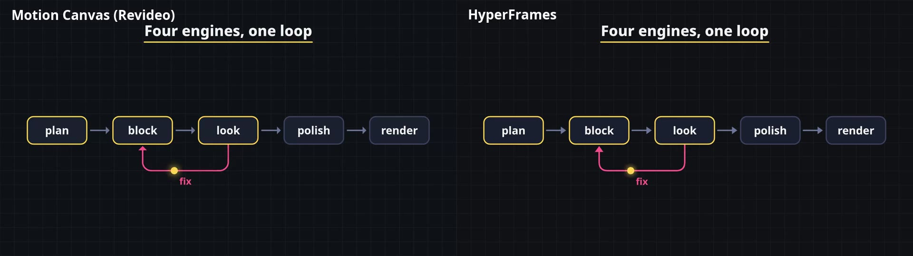

# 9. HyperFrames

HyperFrames is HeyGen's open-source framework for turning HTML, CSS, JavaScript and seekable animations into video. It was added to the study in November 2026, after the original selection. The test was to port the Motion Canvas showcase ("Four engines, one loop") to it beat for beat, render both on the same machine, and check it against the [four things an agent needs](01-framework-selection.md#what-an-agent-needs-from-a-framework).

*Side by side at 4.85 s: [video](../media/showcase-loop-compare.mp4). The HyperFrames render alone: [showcase-hyperframes-loop.mp4](../media/showcase-hyperframes-loop.mp4). Source and brief: [`projects/showcase/hyperframes/`](../projects/showcase/hyperframes/).*

## What it is

| | |
| --- | --- |
| Version tested | `hyperframes` 0.9.98 (npm, 2026-11-26), GSAP 3.15.0, its bundled `chrome-headless-shell` 158, system FFmpeg 7.1 |
| Licence | Apache-2.0. No company licence, unlike Remotion |
| Activity | Repository created 2026-03-10, about 90,000 GitHub stars, releases most days. Still pre-1.0 |
| Scene format | One HTML file per composition. Timed elements carry `data-start` and `data-duration`; one paused GSAP timeline per composition is registered on `window.__timelines` |
| Render | `hyperframes render` seeks the timeline frame by frame in headless Chrome and encodes with FFmpeg. Also WebM and MOV with alpha, GIF, HLS and PNG sequences |
| Install | Node 22+, FFmpeg. About 145 MB of `node_modules` plus about 300 MB of cached Chrome |
| Around it | A desktop editor (HyperFrames Studio), cloud and AWS Lambda rendering, paid templates and media models (Pro), and agent skills installed with `npx skills add heygen-com/hyperframes` |

## The four requirements

| Requirement | Result |
| --- | --- |
| Plain-text scenes | **Yes.** HTML, SVG, CSS and GSAP: the web stack the models know best. The port is one 230-line `index.html`; the original `loop.tsx` is 164 lines |
| Headless render | **Yes.** `npx hyperframes render` with no window. It downloads its own headless Chrome and falls back to software WebGL when there is no usable GPU (as on the GTX 745 here) |
| Deterministic frames | **Visually yes, not byte for byte.** See [determinism](#determinism) |
| Single-frame renders | **Yes, and more.** `snapshot --at 1,3,5` writes PNGs and a numbered contact sheet; `render --start --end` renders a range |

It also ships the [Look step](02-animation-skill.md#the-look-step) as commands. `hyperframes check` runs lint, a runtime check in Chrome, layout overlap, motion and WCAG contrast checks in one gate; `snapshot` builds the contact sheet "for AI review"; `keyframes`, `compare` and `diff` cover onion shots, variant sheets and frame-by-frame scoring against a reference video. The port passed `check` on its first run, and the first contact sheet already matched the beat sheet. The only slip, the diagram sitting 10 px high, showed up in the side-by-side video.

## Render cost

Wall clock for the full 10.72 s clip at 1920×1080, 60 fps, on the [test machine](../README.md#test-machine). Every run starts from the command line, so each includes CLI and browser startup. Renders ran one after another, never at the same time.

| Run | Motion Canvas (Revideo) | HyperFrames, 1 worker | HyperFrames, auto workers |
| --- | --- | --- | --- |
| Disk busy (I/O pressure ≈ 40 %) | 69.6 s | 46.5 s | 51.2 s |
| Quiet, round 2 | 16.8 s | 34.2 s | 24.1 s |
| Quiet, round 3 | 17.1 s | 33.1 s | 42.7 s |
| **Per frame, quiet** | **≈ 0.026 s** | **≈ 0.052 s** | 0.037–0.066 s |

- **About twice Revideo's cost** on a quiet machine with one worker each. Extra workers launch one Chrome each; on this four-core, HDD-bound machine they helped once and hurt once, so one worker is the dependable setting here.
- **A large fixed cost per command.** Rendering one second (60 frames) took 19.5 s. HyperFrames' own render log put the pipeline at about 7 s of that (frame capture 4.8 s, so ≈ 80 ms per frame, and encoding 1.4 s); the rest is CLI startup, the pre-render lint and Chrome launch. A seven-frame `snapshot` took 27 s. Revideo starts in about 4 s, so short preview renders are where the gap hurts the agent's edit, render and look loop most.
- While the disk was busy, HyperFrames suffered less than Revideo.

## Determinism

HyperFrames seeks a paused timeline, so frame N depends only on N, and its docs ask for no `Date.now()`, `Math.random()` or network fetches. Measured:

- **PNG sequence: byte-identical.** Two `--format png-sequence` renders of 3–6 s (180 frames) matched on every frame.
- **MP4: tiny drift.** For MP4 it captures frames as JPEG through Chrome's BeginFrame path, and those captures are not stable between runs. Two full renders differed in 351 of 644 decoded frames, at 62 dB PSNR on average and 54 dB at worst. In one second of captures, 12 of 60 JPEGs differed, all inside a 16×15 px patch around the moving token, by at most 3 levels per channel. Removing the token's glow filter did not make it exact.
- Revideo, by comparison, produced byte-identical decoded frames on two renders, and two Godot recordings matched byte for byte ([reproducing](08-reproduce.md)).

So a fix can still be checked against the frame it was meant to fix, because the drift is invisible. A byte-level comparison, as used for Godot, only works on PNG sequences. HyperFrames offers `render --docker` for strictly reproducible renders; it was not tested here.

## Gotchas

- **Telemetry is on by default.** Set `HYPERFRAMES_NO_TELEMETRY=1` (or `DO_NOT_TRACK=1`), or run `npx hyperframes telemetry disable`. Render telemetry can carry the authoring skill's name.
- **`init` writes agent files.** `hyperframes init` adds `AGENTS.md` and `CLAUDE.md` to the project, offers to install its skills, and pins `npx --yes hyperframes@<version>` in the npm scripts. The port uses a plain `package.json` with `hyperframes` and `gsap` as pinned dev dependencies instead, so `npm ci` gives a local, offline CLI.
- **The default template loads GSAP from a CDN.** The port loads it from `node_modules` and bundles its fonts, so a render needs no network and doesn't depend on system fonts.
- **Measure text after the font loads.** The typed title starts from a fixed left edge, which needs its full width. The port measures it on every update instead of once, so a frame seeked before the font arrived can't keep a stale width.
- **Paused nested timelines don't play.** Only the root timeline on `window.__timelines` is paused; child timelines added to it must not be.

## Verdict

HyperFrames meets all four requirements. Its MP4 output is reproducible to the eye but not byte for byte; its PNG sequences are byte for byte. Against the current Motion Canvas route:

| | Motion Canvas (Revideo) | HyperFrames |
| --- | --- | --- |
| What the agent writes | TypeScript generators, Motion Canvas's own node API | HTML, SVG, CSS and GSAP |
| Upstream | Motion Canvas unreleased since December 2024; the route depends on the Revideo fork | Very active, but pre-1.0 and changing fast |
| Render cost here | ≈ 0.026 s per frame, ≈ 4 s startup | ≈ 0.052 s per frame, ≈ 12 s fixed per command |
| Byte-exact MP4 | Yes | No (PNG sequences are) |
| Checking tools | The skill's own Look step | `check`, `snapshot` contact sheets, `keyframes`, `compare`, `diff` |
| Footage, audio, captions | Supported, not used in this study | Built in: video and audio clips, transcription, captions, loudness tools |
| Strings attached | Revideo telemetry (opt-out) | Telemetry (opt-out), a HeyGen product around the open-source core |

It overlaps the Motion Canvas route for programmed 2D, but it is stronger where that route is weak: web UI and typography, real footage, sound and captions, and a maintained upstream. It is weaker on render speed and byte-exact output. **Recommendation:** add it to the skill as the route for web-native 2D video (UI and product videos, captions, footage edits, explainers with sound), keep Motion Canvas for programmed 2D that needs exact or shared choreography, and revisit render speed when HyperFrames reaches 1.0. Until that decision is recorded in an ADR, the `/animation` skill keeps its four routes.
