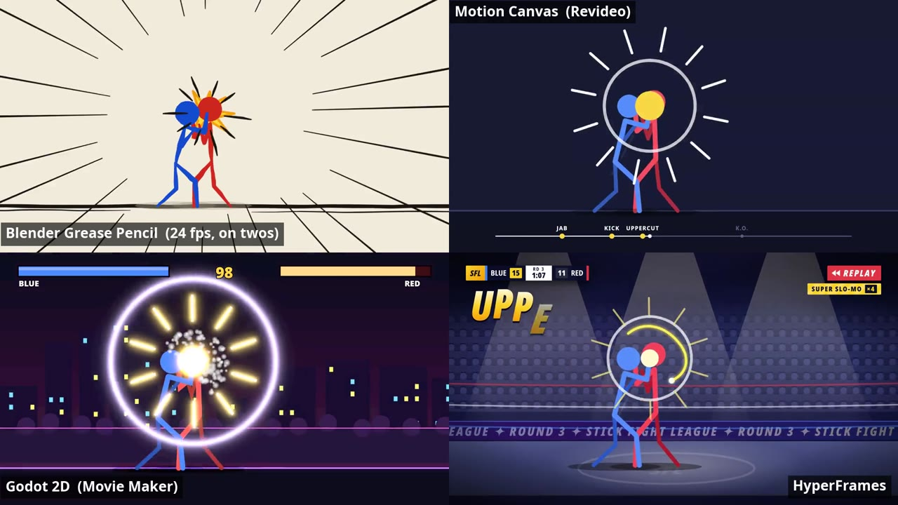
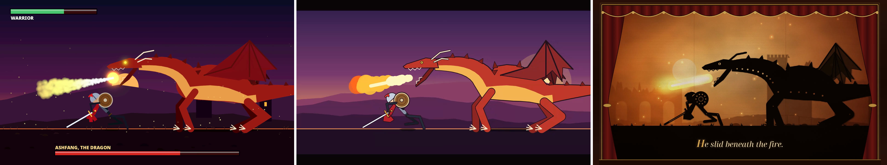

# 10. Every video, side by side

Every finished video of the study, grouped by round, so the routes can be compared on the same task. All are H.264 MP4 at 1920×1080. Render times are wall clock on the [test machine](../README.md#test-machine). The first four routes' times were measured with other renders running at the same time, so compare them by order of magnitude; HyperFrames' were measured alone, on a quiet disk ([why](09-hyperframes.md#render-cost)).

## Showcase: one scene per route, built on its strengths

Different scenes on purpose: each shows what its route does best ([docs/04](04-four-route-showcase.md)).

| Route | Video | Length | Render cost | What it shows |
| --- | --- | --- | --- | --- |
| Blender | [Collapse](../media/showcase-blender-collapse.mp4) | 6.0 s, 24 fps | ≈ 40 s per frame (Cycles) | Path-traced glass and chrome, a rigid-body collapse, depth of field |
| Godot | [Arena](../media/showcase-godot-arena.mp4) | 7.15 s, 60 fps | ≈ 0.33 s per frame | Game feel: hit-stop, physics, particles, a combo counter |
| Three.js | [Field](../media/showcase-threejs-field.mp4) | 7.0 s, 60 fps | ≈ 0.08 s per frame (GPU WebGL) | 14,400 instanced cubes, bloom, a procedural word |
| Motion Canvas | [Loop](../media/showcase-motion-canvas-loop.mp4) | 10.7 s, 60 fps | ≈ 0.024 s per frame | Typography, an animated diagram, a data chart |
| HyperFrames | [Reel](../media/showcase-hyperframes-reel.mp4) | 9.0 s, 60 fps | ≈ 0.19 s per frame (100 s) | A real web page playing real footage, a click-to-expand, CSS captions |

## Head-to-head: the same Loop scene in two renderers

| Route | Video | Render (10.72 s, 644 frames) |
| --- | --- | --- |
| Motion Canvas (Revideo) | [Loop](../media/showcase-motion-canvas-loop.mp4) | 16.8–18.8 s |
| HyperFrames | [Loop port](../media/showcase-hyperframes-loop.mp4) | 33.1–43.6 s |
| Both | [side by side](../media/showcase-loop-compare.mp4) | |

## 2D: one stick fight, four looks

The same 4.5-second fight from one choreography file; every route samples the same poses on the same frame ([docs/05](05-2d-routes.md)).

| Route | Video | Look | Render |
| --- | --- | --- | --- |
| Blender Grease Pencil | [2D fight](../media/2d-fight-grease-pencil.mp4) | Ink on paper, on twos, manga effects | 253 s for 108 frames (24 fps) |
| Motion Canvas | [2D fight](../media/2d-fight-motion-canvas.mp4) | Flat vector, beat timeline | 8 s for 270 frames (13 s re-measured alone) |
| Godot 2D | [2D fight](../media/2d-fight-godot.mp4) | Fighting game: HUD, neon, particles, glow | 58 s for 270 frames |
| HyperFrames | [2D fight](../media/2d-fight-hyperframes.mp4) | TV sports replay: scoreboard, straps, telestrator, captions | 33 s for 270 frames |
| All four | [2×2 grid](../media/2d-fight-compare.mp4) | | |

## Warrior vs Dragon: one baked choreography, three looks

20 seconds, 1200 frames at 60 fps, drawn from the same `bake.json`, so the poses match frame for frame ([docs/06](06-warrior-vs-dragon.md)).

| Route | Video | Look | Render |
| --- | --- | --- | --- |
| Godot 2D | [Warrior vs Dragon](../media/warrior-dragon-godot.mp4) | Game: HUD and boss bar, particle fire, glow, parallax dusk | ≈ 5 min |
| Motion Canvas | [Warrior vs Dragon](../media/warrior-dragon-motion-canvas.mp4) | Flat vector illustration, paper-cut hills, comic bursts | ≈ 50 s (44 s re-measured alone) |
| HyperFrames | [Warrior vs Dragon](../media/warrior-dragon-hyperframes.mp4) | Shadow puppets on a lamp-lit paper screen, storybook captions | 108–114 s |
| All three | [side by side](../media/warrior-dragon-compare.mp4) | | |

## Smoke tests

The first render of each route, as contact sheets: [Blender](images/smoke-blender-sheet.jpg) · [Godot](images/smoke-godot-sheet.jpg) · [Three.js](images/smoke-threejs-sheet.jpg) · [Motion Canvas](images/smoke-motion-canvas-sheet.jpg) · [HyperFrames](images/smoke-hyperframes-sheet.jpg) ([docs/03](03-toolchain-and-smoke-tests.md)).
